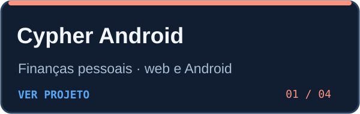
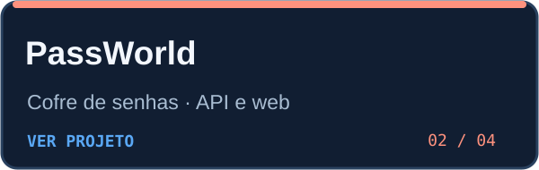
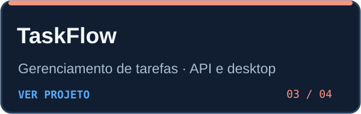
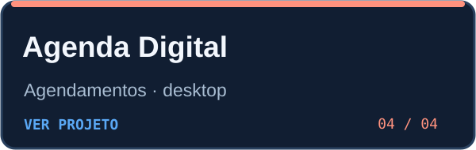

  

  
  

Estudo Engenharia de Software e desenvolvo aplicações de ponta a ponta. Gosto de transformar regras complexas em produtos simples de usar, com atenção a **APIs, dados e segurança aplicada**.

## Projetos selecionados

<table>
<tr>
<td width="50%" valign="top">

Finanças pessoais com transações, orçamentos, metas e faturas. Os dados ficam no dispositivo.

   

</td>
<td width="50%" valign="top">

Cofre de senhas com API em FastAPI e interface Vue. Usa Argon2id e AES-256-GCM no arquivo de dados.

   

</td>
</tr>
<tr>
<td width="50%" valign="top">

API com autenticação JWT e regras de prioridade, acompanhada de um cliente desktop em Tauri.

   

<a href="https://github.com/kakeven/taskflow-desktop">Ver o cliente desktop</a>

</td>
<td width="50%" valign="top">

Agenda de clientes com busca, calendário e acompanhamento de faturamento usando SQLite.

  

</td>
</tr>
</table>

## Ferramentas que uso

  
  
  
  
  
  

**Backend:** Python, FastAPI, SQLAlchemy e PostgreSQL  
**Frontend:** Vue 3, JavaScript, HTML e CSS  
**Apps e dados:** Capacitor, Tauri, Docker e SQLite

## O que me interessa construir

- APIs com regras de negócio claras e testáveis.
- Aplicações que tratam dados locais com cuidado.
- Interfaces que tornam fluxos complexos mais fáceis de entender.

## Contato

Fale comigo pelo [LinkedIn](https://www.linkedin.com/in/kakeven) ou explore meus [repositórios públicos](https://github.com/kakeven?tab=repositories).
