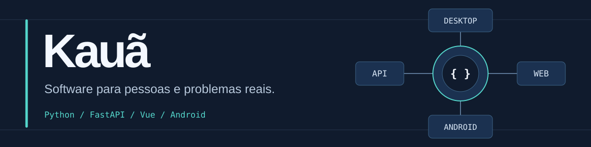

  

  <a href="https://github.com/kakeven?tab=repositories">Repositórios</a> ·
  <a href="https://www.linkedin.com/in/kakeven">LinkedIn</a>

## Olá, eu sou o Kauã

Estudo Engenharia de Software e desenvolvo aplicações de ponta a ponta, com atenção especial a APIs, persistência de dados e segurança aplicada. Gosto de transformar regras complexas em produtos simples de usar.

Meu trabalho passa por **Python e FastAPI** no backend, **Vue** na web e experiências para **desktop e Android**.

## Projetos em destaque

### [Cypher Android](https://github.com/kakeven/cypher-android)

Aplicativo open source de finanças pessoais para navegador e Android. Organiza transações, orçamentos, metas, recebimentos, recorrências e faturas de cartão, com armazenamento local no dispositivo.

`Vue 3` `Ionic` `Capacitor` `SQLite`

### [PassWorld](https://github.com/kakeven/Passworld)

Cofre de senhas com API em FastAPI e interface em Vue. O projeto usa Argon2id para derivar a chave e AES-256-GCM para cifrar o arquivo de dados `.vault`.

`Python` `FastAPI` `Vue 3` `Criptografia aplicada`

### [TaskFlow API](https://github.com/kakeven/TaskFlow-API) + [TaskFlow Desktop](https://github.com/kakeven/taskflow-desktop)

Dois projetos de gerenciamento de tarefas: uma API com autenticação JWT e regras de prioridade e carga de trabalho, e um cliente desktop feito com Tauri.

`FastAPI` `PostgreSQL` `SQLAlchemy` `Tauri`

### [Agenda Digital](https://github.com/kakeven/Agenda-digital)

Aplicativo desktop para agendamentos de clientes, busca, calendário e acompanhamento de faturamento com dados em SQLite.

`Python` `Tkinter` `SQLite`

## O que me interessa construir

- APIs com regras de negócio claras e testáveis.
- Aplicações que tratam dados locais com cuidado.
- Interfaces que tornam fluxos complexos mais fáceis de entender.

## Tecnologias

**Backend:** Python, FastAPI, SQLAlchemy, PostgreSQL  
**Frontend:** Vue 3, JavaScript, HTML e CSS  
**Apps e ferramentas:** Capacitor, Tauri, Docker, SQLite

## Contato

Você pode falar comigo pelo [LinkedIn](https://www.linkedin.com/in/kakeven) ou explorar os [repositórios públicos](https://github.com/kakeven?tab=repositories).

